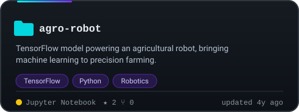
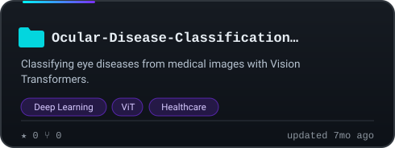
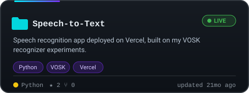
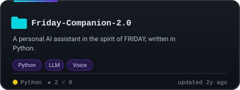
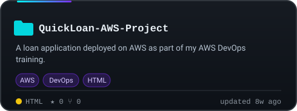
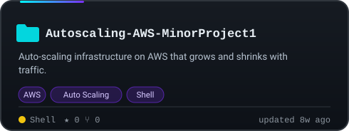
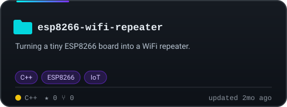
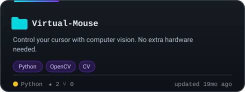
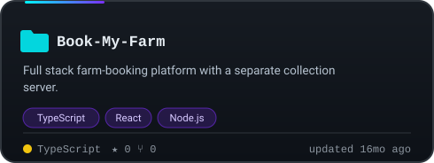
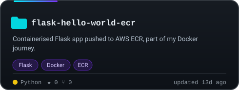

 

  

<!--START_SECTION:spotlight-->
> 🎯 **Repo of the day:** [desktop-tutorial](https://github.com/Shyamnair488/desktop-tutorial) — GitHub Desktop tutorial repository  
> ★ 0 · updated 2y ago
>
> 💭 *Done is better than perfect, but shipped is better than done.*
<!--END_SECTION:spotlight-->

## 🎮 Player Stats

  
  
  
  

🧮 Level, XP, achievements, radar and language mix are computed from my repositories every 6 hours.

## 🛰️ Tech Orbit

  

<b>Prefer plain text? Full tech list</b>

- **Languages:** Python, JavaScript, TypeScript, C++, C, Java, R, Shell
- **Frontend:** HTML, CSS, React, Next.js, Tailwind CSS, Bootstrap, Vite
- **Backend and data:** Node.js, Express, Flask, PostgreSQL, MongoDB, Firebase
- **Cloud and DevOps:** AWS (EC2, ECR, Auto Scaling), Docker, Docker Compose, Git, Linux, Vercel
- **AI / ML:** TensorFlow, TFLite, scikit-learn, Pandas, NumPy, OpenCV, Vision Transformers, VOSK
- **IoT:** ESP8266, ESP32, Arduino, Raspberry Pi
- **Also:** Salesforce LWC, n8n automation

## 🏆 Featured Projects

Cards are generated from the live repo data, so stars and update times stay current.

<!--START_SECTION:featured-->

<!--END_SECTION:featured-->

## 📈 Momentum

  

### 🔥 Recently Active

<!--START_SECTION:recent-repos-->
| 📦 Repository | 💬 About | 🧪 Language | ⭐ | 🕒 Last push |
|:--|:--|:--:|:--:|:--:|
| [**kubelab-eks-devops**](https://github.com/Shyamnair488/kubelab-eks-devops) | — | HTML | 0 | 1d ago |
| [**flask-hello-world-ecr**](https://github.com/Shyamnair488/flask-hello-world-ecr) | — | Python | 0 | 2w ago |
| [**Docker-Zero-to-Hero**](https://github.com/Shyamnair488/Docker-Zero-to-Hero) | — | JavaScript | 0 | 2w ago |
| [**docker-compose-project-python-flask**](https://github.com/Shyamnair488/docker-compose-project-python-flask) | — | Python | 0 | 3w ago |
| [**QuickLoan-AWS-Project**](https://github.com/Shyamnair488/QuickLoan-AWS-Project) | — | HTML | 0 | 7w ago |
| [**Autoscaling-AWS-MinorProject1**](https://github.com/Shyamnair488/Autoscaling-AWS-MinorProject1) | — | Shell | 0 | 2mo ago |
<!--END_SECTION:recent-repos-->

### 📡 Latest Activity

<!--START_SECTION:activity-->
- 🌍 Open-sourced [Shyamnair488/kubelab-eks-devops](https://github.com/Shyamnair488/kubelab-eks-devops) · 2d ago
- ⬆️ Pushed to [Shyamnair488/shyamnair488](https://github.com/Shyamnair488/shyamnair488) · 2d ago
- ⭐ Starred [morluto/rea](https://github.com/morluto/rea) · 2d ago
- 🍴 Forked [morluto/rea](https://github.com/morluto/rea) · 2d ago
- 🌍 Open-sourced [Shyamnair488/5-Day-AI-Agents-Intensive-Course-with-Google](https://github.com/Shyamnair488/5-Day-AI-Agents-Intensive-Course-with-Google) · 11mo ago
- 🌍 Open-sourced [Shyamnair488/villa-haven-book](https://github.com/Shyamnair488/villa-haven-book) · 16mo ago
- ⬆️ Pushed to [Shyamnair488/shyamnair488](https://github.com/Shyamnair488/shyamnair488) · 3d ago
- 🍴 Forked [avi691/linkedin-agent-skill](https://github.com/avi691/linkedin-agent-skill) · 5d ago
<!--END_SECTION:activity-->

## 🐍 Contribution Snake

  <picture>
    <source media="(prefers-color-scheme: dark)" srcset="https://raw.githubusercontent.com/Shyamnair488/shyamnair488/output/github-contribution-grid-snake-dark.svg"/>
    <source media="(prefers-color-scheme: light)" srcset="https://raw.githubusercontent.com/Shyamnair488/shyamnair488/output/github-contribution-grid-snake.svg"/>
    
  </picture>

## 🗂️ Every Repository · auto-generated · 🍴 = fork

<!--START_SECTION:all-repos-->

<b>Jupyter Notebook</b> &nbsp;(22)

- [5-Day-AI-Agents-Intensive-Course-with-Google](https://github.com/Shyamnair488/5-Day-AI-Agents-Intensive-Course-with-Google) — 5-Day AI Agents Intensive Course with Google
- [MNIST-Website](https://github.com/Shyamnair488/MNIST-Website)
- [Computer-Vision-Trials](https://github.com/Shyamnair488/Computer-Vision-Trials)
- [Data-Science-Practical](https://github.com/Shyamnair488/Data-Science-Practical)
- [Great-Learning-](https://github.com/Shyamnair488/Great-Learning-)
- [Natural-Language-Processing-Practical](https://github.com/Shyamnair488/Natural-Language-Processing-Practical)
- [Machine-Learning-Algorithm-Practical](https://github.com/Shyamnair488/Machine-Learning-Algorithm-Practical)
- [Soft-Computing-Practical-](https://github.com/Shyamnair488/Soft-Computing-Practical-)
- [Tflite-ML-Code](https://github.com/Shyamnair488/Tflite-ML-Code)
- [Data-Preprocessing-Practical](https://github.com/Shyamnair488/Data-Preprocessing-Practical)
- [Deep-Learning-Practicals](https://github.com/Shyamnair488/Deep-Learning-Practicals)
- [Reinforcement-Learning-Practical-](https://github.com/Shyamnair488/Reinforcement-Learning-Practical-)
- [Mathematical-Foundation-for-Machine-learning-Practical-](https://github.com/Shyamnair488/Mathematical-Foundation-for-Machine-learning-Practical-)
- [Image-Detection-Using-TensorFlow](https://github.com/Shyamnair488/Image-Detection-Using-TensorFlow)
- [FREECODECAMP-ML-Code](https://github.com/Shyamnair488/FREECODECAMP-ML-Code)
- [InterPe-Internship-Data-Block](https://github.com/Shyamnair488/InterPe-Internship-Data-Block)
- [Handwritten-Digit-Recognition](https://github.com/Shyamnair488/Handwritten-Digit-Recognition) — This repository contains code for a simple web application that recognizes hand…
- [Bharat-Intern-ML-Code-Hub](https://github.com/Shyamnair488/Bharat-Intern-ML-Code-Hub) — All 3 tasks aviliabe
- [MNIST-Webcam-Prediction](https://github.com/Shyamnair488/MNIST-Webcam-Prediction)
- [Detection_using_tflite](https://github.com/Shyamnair488/Detection_using_tflite)
- [ML-Bootcamp](https://github.com/Shyamnair488/ML-Bootcamp) 🍴
- [agro-robot](https://github.com/Shyamnair488/agro-robot) — agro robot tensorflow model

<b>TypeScript</b> &nbsp;(18)

- [docucraft-ai](https://github.com/Shyamnair488/docucraft-ai)
- [villa-haven-book](https://github.com/Shyamnair488/villa-haven-book) · [🔴 live](https://villa-haven-book.vercel.app)
- [buzz-code-academy](https://github.com/Shyamnair488/buzz-code-academy)
- [Avil-Milk](https://github.com/Shyamnair488/Avil-Milk)
- [document-dynamo](https://github.com/Shyamnair488/document-dynamo)
- [commit-booster](https://github.com/Shyamnair488/commit-booster)
- [lovable-gallery](https://github.com/Shyamnair488/lovable-gallery)
- [learn-with-bees](https://github.com/Shyamnair488/learn-with-bees)
- [tuition-sparkle-web](https://github.com/Shyamnair488/tuition-sparkle-web)
- [carpet-corner-commerce-bot](https://github.com/Shyamnair488/carpet-corner-commerce-bot)
- [Book-My-Farm](https://github.com/Shyamnair488/Book-My-Farm)
- [commit-streak-booster](https://github.com/Shyamnair488/commit-streak-booster)
- [New-Type-of-Carousel](https://github.com/Shyamnair488/New-Type-of-Carousel)
- [Trial1](https://github.com/Shyamnair488/Trial1) · [🔴 live](https://trial1-alpha.vercel.app)
- [enchanting-site-rebirth-main](https://github.com/Shyamnair488/enchanting-site-rebirth-main)
- [nextjs](https://github.com/Shyamnair488/nextjs) · [🔴 live](https://nextjs-five-mu-57.vercel.app)
- [devrath-industries](https://github.com/Shyamnair488/devrath-industries)
- [Hello-lets-try](https://github.com/Shyamnair488/Hello-lets-try)

<b>Python</b> &nbsp;(14)

- [flask-hello-world-ecr](https://github.com/Shyamnair488/flask-hello-world-ecr)
- [docker-compose-project-python-flask](https://github.com/Shyamnair488/docker-compose-project-python-flask)
- [Virtual-Mouse](https://github.com/Shyamnair488/Virtual-Mouse)
- [Speech-to-Text](https://github.com/Shyamnair488/Speech-to-Text) · [🔴 live](https://speech-to-text-nine-mauve.vercel.app)
- [Friday-Companion-2.0](https://github.com/Shyamnair488/Friday-Companion-2.0)
- [LLM-Model-testing](https://github.com/Shyamnair488/LLM-Model-testing)
- [Speech-Reorganization-Model-Testing](https://github.com/Shyamnair488/Speech-Reorganization-Model-Testing) — Testing VOSK Speech Recoginizer Model
- [Data-Extraction-from-ESP-8266-Using-Vs-code](https://github.com/Shyamnair488/Data-Extraction-from-ESP-8266-Using-Vs-code)
- [Object_Detection_Code](https://github.com/Shyamnair488/Object_Detection_Code)
- [ML-Model-Suggestor](https://github.com/Shyamnair488/ML-Model-Suggestor)
- [Alarm-Clock](https://github.com/Shyamnair488/Alarm-Clock)
- [Virtual-Hand-Mouse](https://github.com/Shyamnair488/Virtual-Hand-Mouse)
- [AI-Friday-Companion](https://github.com/Shyamnair488/AI-Friday-Companion) — Welcome to AI-Friday-Companion, your intelligent AI assistant! Engage in seamle…
- [Alarm_Clock](https://github.com/Shyamnair488/Alarm_Clock)

<b>JavaScript</b> &nbsp;(10)

- [Docker-Zero-to-Hero](https://github.com/Shyamnair488/Docker-Zero-to-Hero)
- [barber-booking-AWS-MinorProject2](https://github.com/Shyamnair488/barber-booking-AWS-MinorProject2)
- [Housie-HTML-Website](https://github.com/Shyamnair488/Housie-HTML-Website) — Housie HTML Website · [🔴 live](https://housie-html-website.vercel.app)
- [SUN](https://github.com/Shyamnair488/SUN) · [🔴 live](https://sun-fawn-alpha.vercel.app)
- [Book-My-Farm-Collection-server](https://github.com/Shyamnair488/Book-My-Farm-Collection-server)
- [Email-Js](https://github.com/Shyamnair488/Email-Js)
- [React-SS-Infotech-](https://github.com/Shyamnair488/React-SS-Infotech-)
- [JS-Practice-](https://github.com/Shyamnair488/JS-Practice-)
- [SET-UP-TAILWIND-CSS](https://github.com/Shyamnair488/SET-UP-TAILWIND-CSS)
- [Weather-Website](https://github.com/Shyamnair488/Weather-Website)

<b>HTML</b> &nbsp;(7)

- [kubelab-eks-devops](https://github.com/Shyamnair488/kubelab-eks-devops)
- [QuickLoan-AWS-Project](https://github.com/Shyamnair488/QuickLoan-AWS-Project)
- [LWC](https://github.com/Shyamnair488/LWC)
- [Daily-WEBD-data](https://github.com/Shyamnair488/Daily-WEBD-data)
- [WebD](https://github.com/Shyamnair488/WebD)
- [ToDo-List](https://github.com/Shyamnair488/ToDo-List)
- [Dice-Roller](https://github.com/Shyamnair488/Dice-Roller)

<b>C++</b> &nbsp;(5)

- [esp8266-wifi-repeater](https://github.com/Shyamnair488/esp8266-wifi-repeater)
- [IOT-PROJECT](https://github.com/Shyamnair488/IOT-PROJECT)
- [Arduino-ESP8266-IOT-Projects](https://github.com/Shyamnair488/Arduino-ESP8266-IOT-Projects)
- [Arduino-Esp8266-and-ESP32-Projects](https://github.com/Shyamnair488/Arduino-Esp8266-and-ESP32-Projects)
- [Home-Automation-With-ESP8266](https://github.com/Shyamnair488/Home-Automation-With-ESP8266)

<b>Java</b> &nbsp;(2)

- [CV-ROBO-Backend-files](https://github.com/Shyamnair488/CV-ROBO-Backend-files)
- [JAVA](https://github.com/Shyamnair488/JAVA)

<b>R</b> &nbsp;(1)

- [Movie_Recommendation_Using_R](https://github.com/Shyamnair488/Movie_Recommendation_Using_R) — This project offers a dynamic movie recommendation system developed using R. Wh…

<b>Shell</b> &nbsp;(1)

- [Autoscaling-AWS-MinorProject1](https://github.com/Shyamnair488/Autoscaling-AWS-MinorProject1)

<b>Other</b> &nbsp;(36)

- [rea](https://github.com/Shyamnair488/rea) 🍴 — Reverse engineer anything with agents, from app behavior down to native binarie…
- [geo-sleuth](https://github.com/Shyamnair488/geo-sleuth) 🍴 — An agent skill that finds where a photo was taken — OpenStreetMap geometry, ele…
- [ai-engineering-from-scratch](https://github.com/Shyamnair488/ai-engineering-from-scratch) 🍴 — Learn AI Engineering! Learn it. Build it. Ship it for others.
- [Strata](https://github.com/Shyamnair488/Strata) 🍴 — Qwen3.8-Flash-Next on any consumer hardware: one-click install for Windows / Li…
- [pcbu-desktop](https://github.com/Shyamnair488/pcbu-desktop) 🍴 — Desktop app for PC Bio Unlock
- [linkedin-agent-skill](https://github.com/Shyamnair488/linkedin-agent-skill) 🍴 — Eleven free Claude skills that run a LinkedIn account: posts off 21 hook formul…
- [MiroFish](https://github.com/Shyamnair488/MiroFish) 🍴 — A Simple and Universal Swarm Intelligence Engine, Predicting Anything. 简洁通用的群体智…
- [Git-Advanced-Commands](https://github.com/Shyamnair488/Git-Advanced-Commands) 🍴 — 22-07-2026 / AWS DevOps / Git Advanced Commands
- [linkedin-skills](https://github.com/Shyamnair488/linkedin-skills) 🍴 — Claude skills for LinkedIn. 11 Claude Code and Codex skills that write human-so…
- [MinecraftForge](https://github.com/Shyamnair488/MinecraftForge) 🍴 — Modifications to the Minecraft base files to assist in compatibility between mo…
- [ultronmain](https://github.com/Shyamnair488/ultronmain) 🍴 — ultron main
- [QuickLoan-Highly-Available-Loan-Application-Deployment-on-AWS](https://github.com/Shyamnair488/QuickLoan-Highly-Available-Loan-Application-Deployment-on-AWS) 🍴 — The objective of this project was to deploy a multi-tier Loan Application on AW…
- [turbovec](https://github.com/Shyamnair488/turbovec) 🍴 — A vector index built on TurboQuant, written in Rust with Python bindings
- [bumblebee](https://github.com/Shyamnair488/bumblebee) 🍴 — Read-only developer endpoint scanner for on-disk package, extension, and develo…
- [RuView](https://github.com/Shyamnair488/RuView) 🍴 — π RuView turns commodity WiFi signals into real-time spatial intelligence, vita…
- [mythos-agent](https://github.com/Shyamnair488/mythos-agent) 🍴 — The AI security agent guards your code.
- [swarm-forge](https://github.com/Shyamnair488/swarm-forge) 🍴 — A simple tool for coordinating several AI agents.
- [mythos-agent.](https://github.com/Shyamnair488/mythos-agent.) 🍴 — 🧠 Local AI agent inspired by Claude Mythos — Multi-model routing, autonomous to…
- [Ocular-Disease-Classification-Using-Vision-Transformers](https://github.com/Shyamnair488/Ocular-Disease-Classification-Using-Vision-Transformers)
- [3d-portfolio](https://github.com/Shyamnair488/3d-portfolio) 🍴 — 3d portfolio website which devs can use
- [joinly](https://github.com/Shyamnair488/joinly) 🍴 — Make your meetings accessible to AI Agents
- [public-apis](https://github.com/Shyamnair488/public-apis) 🍴 — A collective list of free APIs
- [agentic](https://github.com/Shyamnair488/agentic) 🍴 — Hands-on LLM Engineering including Agentic AI Project
- [awesome-llm-apps](https://github.com/Shyamnair488/awesome-llm-apps) 🍴 — Collection of awesome LLM apps with AI Agents and RAG using OpenAI, Anthropic,…
- [grafify](https://github.com/Shyamnair488/grafify) 🍴 — Easy grafs, ANOVAs and posthoc comparisons.
- [ecommerce-database-schema](https://github.com/Shyamnair488/ecommerce-database-schema)
- [N8n---Ai-Automation-Workflow](https://github.com/Shyamnair488/N8n---Ai-Automation-Workflow)
- [improving-RAG-systems-dhs2024](https://github.com/Shyamnair488/improving-RAG-systems-dhs2024) 🍴 — This repository will contain the presentation and python jupyter notebooks for…
- [30-Days-Of-JavaScript](https://github.com/Shyamnair488/30-Days-Of-JavaScript) 🍴 — 30 days of JavaScript programming challenge is a step-by-step guide to learn Ja…
- [CultiKure-Disease-Prediction](https://github.com/Shyamnair488/CultiKure-Disease-Prediction) 🍴 — The Plant Disease Detection Web Application, known as 'CultiKure,' is a web-bas… · [🔴 live](https://culti-kure-disease-prediction.vercel.app)
- [desktop-tutorial](https://github.com/Shyamnair488/desktop-tutorial) — GitHub Desktop tutorial repository
- [Hacknow-Hackathon-Submission-2023](https://github.com/Shyamnair488/Hacknow-Hackathon-Submission-2023) 🍴 — Github Link Guidelins Repository must be public. Must include readme file in it…
- [Detection-image](https://github.com/Shyamnair488/Detection-image)
- [100-days-of-code-python](https://github.com/Shyamnair488/100-days-of-code-python) 🍴 — 100 Days of Code: The Complete Python Pro Bootcamp
- [shyam](https://github.com/Shyamnair488/shyam)
- [shyam-nair](https://github.com/Shyamnair488/shyam-nair)

<!--END_SECTION:all-repos-->

## 🤝 Let's Build Something

I'm open to **internships, freelance work and collaborations** in full stack development, cloud deployments, IoT and applied ML. If you have an idea, a bug, or a board that needs flashing, say hello.

  

<!--START_SECTION:updated-->
🤖 Auto-generated by GitHub Actions · last refreshed <b>21 Oct 2026, 11:57 UTC</b>
<!--END_SECTION:updated-->

