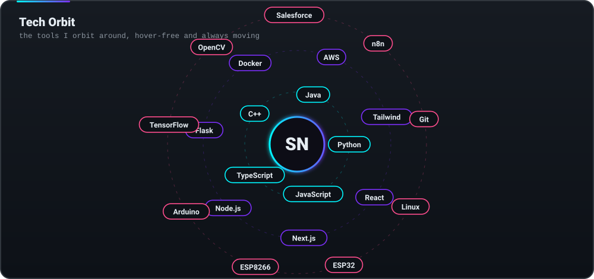

 

  

<!--START_SECTION:spotlight-->
<!--END_SECTION:spotlight-->

## 🎮 Player Stats

  
  
  
  

🧮 Level, XP, achievements, radar and language mix are computed from my repositories every 6 hours.

## 🛰️ Tech Orbit

  

<b>Prefer plain text? Full tech list</b>

- **Languages:** Python, JavaScript, TypeScript, C++, C, Java, R, Shell
- **Frontend:** HTML, CSS, React, Next.js, Tailwind CSS, Bootstrap, Vite
- **Backend and data:** Node.js, Express, Flask, PostgreSQL, MongoDB, Firebase
- **Cloud and DevOps:** AWS (EC2, ECR, Auto Scaling), Docker, Docker Compose, Git, Linux, Vercel
- **AI / ML:** TensorFlow, TFLite, scikit-learn, Pandas, NumPy, OpenCV, Vision Transformers, VOSK
- **IoT:** ESP8266, ESP32, Arduino, Raspberry Pi
- **Also:** Salesforce LWC, n8n automation

## 🏆 Featured Projects

Cards are generated from the live repo data, so stars and update times stay current.

<!--START_SECTION:featured-->
<!--END_SECTION:featured-->

### 🔴 Live on the Web

<!--START_SECTION:live-sites-->
<!--END_SECTION:live-sites-->

## 📈 Momentum

  

### 🔥 Recently Active

<!--START_SECTION:recent-repos-->
<!--END_SECTION:recent-repos-->

### 📡 Latest Activity

<!--START_SECTION:activity-->
<!--END_SECTION:activity-->

## 🐍 Contribution Snake

  <picture>
    <source media="(prefers-color-scheme: dark)" srcset="https://raw.githubusercontent.com/Shyamnair488/shyamnair488/output/github-contribution-grid-snake-dark.svg"/>
    <source media="(prefers-color-scheme: light)" srcset="https://raw.githubusercontent.com/Shyamnair488/shyamnair488/output/github-contribution-grid-snake.svg"/>
    
  </picture>

## 🗂️ Every Repository · auto-generated · 🍴 = fork

<!--START_SECTION:all-repos-->
<!--END_SECTION:all-repos-->

## 🤝 Let's Build Something

I'm open to **internships, freelance work and collaborations** in full stack development, cloud deployments, IoT and applied ML. If you have an idea, a bug, or a board that needs flashing, say hello.

  

<!--START_SECTION:updated-->
<!--END_SECTION:updated-->

